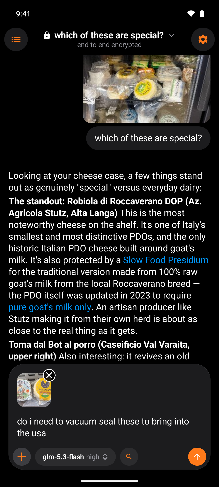

# teemoon for Android

**private AI chat, your key.**

[teemoon.ai](https://teemoon.ai) · [Google Play](https://play.google.com/store/apps/details?id=ai.teemoon) · [changelog](CHANGELOG.md) · [audit](https://github.com/teemoonai/audits/tree/main/client/teemoon-android) · Android 10+, 64-bit

teemoon is a private AI chat app with no teemoon server: your phone talks directly to the model you pick — on the phone, on a computer you own, or in a cloud with your own key. no account, no analytics; keys are kept encrypted on the phone under a key the Android Keystore holds, and chats stay on the device. this is the Android client. it follows [teemoon-ios](https://github.com/teemoonai/teemoon-ios)'s design and checks; where Android does something its own way, [`docs/ANDROID_NATIVE.md`](docs/ANDROID_NATIVE.md) lists it.

## new in 1.1.1

- **every enclave near.ai lists is checked.** near.ai runs a model on more than one secure enclave under one key; before a sealed send your phone now checks each enclave near.ai lists for it, not only the first, and the worst result wins.
- **who holds the key, said plainly.** the trust screens say that near.ai's key service decides which secure enclaves get the key, and what teemoon found for the enclaves near.ai listed.
- **an ask before a plain send.** a near.ai model you've sent to sealed asks once before its first send without encryption.

new in 1.1.0: images (paste, share in or take a photo, decoded in an isolated process) and near.ai Private Chat import.

full list: [`CHANGELOG.md`](CHANGELOG.md).



## install

**[get it on google play](https://play.google.com/store/apps/details?id=ai.teemoon).**

**without google play** (e.g. GrapheneOS): download the apk from [releases](https://github.com/teemoonai/teemoon-android/releases/latest) or its mirror on [teemoon.ai](https://teemoon.ai). it's signed with the Play build's key, so either install updates the other:

```
8A:20:9E:D1:B6:94:AA:B9:B4:8E:1F:C2:10:C0:79:FB:12:44:C1:63:D5:8D:BB:9C:50:58:A8:E0:64:B7:4C:A8
```

the GitHub apk contains no Google Play libraries; the Play build is the same source plus Google's in-app review prompt. updates through [Obtainium](https://apps.obtainium.imranr.dev/redirect?r=obtainium://add/https://github.com/teemoonai/teemoon-android). each GitHub release is rebuilt from its tag and compared with the apk, entry by entry, signature aside: [`docs/REPRODUCIBLE.md`](docs/REPRODUCIBLE.md).

## features

- **one app, three places to run a model.** on the phone: Gemma 4 via LiteRT-LM, offline, on the NPU, GPU or CPU. on a computer you own: ollama, LM Studio, llama.cpp or any OpenAI-compatible server on your network, and you can pull models onto your ollama server from the app. in the cloud: any OpenAI-compatible endpoint, with presets for near.ai, Grok, Fireworks, OpenRouter, NVIDIA or Brave Answers, and live model lists with prices and per-model capabilities.
- **verified end-to-end encryption.** near.ai models that run in attested secure enclaves are sealed end to end, and your phone verifies the enclave itself: the Intel TDX quote against Intel's data, the GPU evidence through NVIDIA's service, and, in a separate probe of the model's host, that its certificate is the one its attestation names. a failed check blocks the send; one it can't finish asks first. every other cloud provider is plain TLS, and the app says so on the row. the limit: near.ai runs each model on more than one secure enclave, and they share one encryption key, and near.ai's key service decides which enclaves get it. since 1.1.1 the app checks every enclave near.ai lists for the model before a sealed send, and the worst result wins; an enclave the key service admits that near.ai doesn't list can still hold the key, and the app can't check it.
- **audited.** each release's tagged commit gets a review of every way the app could pass your API keys or your messages to anyone but the provider you chose, published in [teemoonai/audits](https://github.com/teemoonai/audits/tree/main/client/teemoon-android): teemoon's own AI-assisted review, not an audit by an outside firm. near.ai's confidential-inference stack is reviewed in the same repo, per attested identity, and the app shows an audit link for a near.ai enclave only when its exact identity is listed there.
- **images.** take a photo, pick from your photos or paste — up to 10 per message, to a cloud or home model that reads images, or to Gemma 4 on the phone when the phone has the memory for it (a phone that can never fit it says so and offers the smaller model). every image is decoded in an isolated process with no permissions (JPEG, PNG, GIF and BMP by the memory-safe Wuffs) and re-encoded from its pixels, so no EXIF, XMP or GPS location is kept or sent: [`docs/IMAGE_DECODER.md`](docs/IMAGE_DECODER.md). the model picker can show only the models that read images. share text or photos into teemoon from any app; it opens as a draft, and nothing is sent until you tap send.
- **bring your near.ai chats.** import near.ai Private Chat's export file: your chats' text, and their images where the export embeds them. imported chats keep their near.ai titles.
- **web search.** Brave's LLM context API, streaming, with sources beside the reply. on near.ai the tool call, query and results stay end-to-end encrypted; Brave sees only the search itself, sent from your phone with your key. with no Brave key, a model that wants the web offers to add one, and nothing is sent to Brave until you do.
- **chat search.** on the phone and offline, across messages and chat titles.
- **the request, as sent.** developer mode shows each reply's request, keys masked.
- **one permission prompt.** notifications, to say a reply is ready. the rest are granted at install and ask nothing: internet, network state, a foreground service (two grants) so a reply or a download can finish after you leave the app, and the app's own guard on its internal broadcasts. a photo is taken by the system camera app, so teemoon asks for no camera permission.

### only on Android

- **fast.** on-phone Gemma 4 E2B decodes at 96.9 tok/s on a Galaxy S26 Ultra's GPU when editing code with speculative decoding (Gemma's own drafter; 56–59 tok/s for summaries, long retellings and short answers; Samsung Remote Test Lab, 2026-10-15, medians of 3), and a Galaxy S25 Ultra's NPU prefills a 1,024-token prompt at 8,661 tok/s with the first token in 0.14 s (Samsung Remote Test Lab, 2026-10-14, Google's benchmark method, medians of 3); both on LiteRT-LM 0.18 (LiteRT 2.3), the version 1.1.0 ships. teemoon turns speculative decoding on where it measured faster — Snapdragon GPUs — and picks the NPU, GPU or CPU for each phone, proving each with a test token before using it. NPU support follows the Gemma 4 bundles Google publishes: Google Tensor G5 and G6 (Pixel 10 and 11 series, except the Pixel 10a) and the Snapdragon 8 Elite (Galaxy S25, S25+, S25 Ultra, S25 Edge, Z Fold7, OnePlus 13, Xiaomi 15 series and other 8 Elite phones; not the S25 FE or Z Flip7, which use Exynos). every other phone runs on its GPU or CPU.
- **answers that finish in the background.** a large cloud model can take minutes to answer. leave the app and it keeps going under a foreground service, then a notification says it's ready — never what it says, and not the chat's title. (iOS can't hold a streaming connection in the background.)
- **reproducible builds.** every GitHub release is rebuilt from its tag on a clean runner and compared with the published apk, entry by entry with the signature set aside; the verdict is in the release notes, and [`docs/REPRODUCIBLE.md`](docs/REPRODUCIBLE.md) shows how to check it yourself.

## security and audits

- **reporting.** security issues go through [private vulnerability reporting](https://github.com/teemoonai/teemoon-android/security/advisories/new), not a public issue; see [`SECURITY.md`](SECURITY.md).
- **audits.** each release's audit page is in [teemoonai/audits](https://github.com/teemoonai/audits/tree/main/client/teemoon-android). it is teemoon's own AI-assisted review, not an audit by an outside firm; earlier releases' pages, including [1.1.0's](https://github.com/teemoonai/audits/blob/main/client/teemoon-android/v1.1.0-3918-ee2c8b3.md), are in [teemoonai/audits](https://github.com/teemoonai/audits/tree/main/client/teemoon-android).
- **reproducible.** each GitHub release's notes carry its rebuild verdict, 1.1.1's on [its release](https://github.com/teemoonai/teemoon-android/releases/tag/v1.1.1-3919). 1.1.0 (3918) is **verified**: a clean rebuild of tag `v1.1.0-3918` on GitHub Actions matches the published apk, 198 entries compared, signature files set aside ([run](https://github.com/teemoonai/teemoon-android/actions/runs/44283096289)).
- **known issues.** open issues and known limits for each release are listed in [`CHANGELOG.md`](CHANGELOG.md).

## building and testing

JDK 25 and the Android SDK (platform 37); no keys.

```
./gradlew :app:assembleDebug           # a debug build, beside the Play app
./gradlew test                         # the JVM suite, offline
./gradlew :app:verifyPaparazziDebug    # every screen against its snapshot
tools/device_suite.sh UserJourneysTest # the user journeys on a device
```

tests that call the real model providers (near.ai, OpenRouter and the rest, with your own keys, a few cents a run) are opt-in; see [`tools/live_cloud_suite.sh`](tools/live_cloud_suite.sh). [`docs/ARCHITECTURE.md`](docs/ARCHITECTURE.md) is the map of the code, and [`ports.json`](ports.json) names the Swift file each Kotlin file follows. most also name the teemoon-ios release tag whose source matches it byte for byte. where a file follows a later iOS change, it names a teemoon-ios development commit instead; that history is private, so those references can't be checked against the public repo. the audit doesn't rely on them: each release's audit page names the tagged commit of this repository that it reviewed.

## contributing

bug reports and pull requests are welcome; fixes come with a regression test. copy that overstates what the code verifies is treated as a bug. teemoon is AGPL-3.0 and also distributed on Google Play by the copyright holder, so contributions may need a CLA — see [`CONTRIBUTING.md`](CONTRIBUTING.md). security issues: [private vulnerability reporting](https://github.com/teemoonai/teemoon-android/security/advisories/new), not a public issue.

## cryptography notice

this distribution includes cryptographic software. the country in which you currently reside may have restrictions on the import, possession, use, and/or re-export to another country of encryption software. before using it, check your country's laws and regulations concerning the import, possession, use, and re-export of encryption software. teemoon uses only standard, published algorithms (X25519/Ed25519, XChaCha20-Poly1305, HKDF, SHA-2, ECDSA, AES-GCM, TLS).

## license

copyright 2026 ringzero ventures llc, licensed under the [GNU AGPLv3](https://www.gnu.org/licenses/agpl-3.0.html). third-party notices are in [`THIRD_PARTY_NOTICES.md`](THIRD_PARTY_NOTICES.md).
